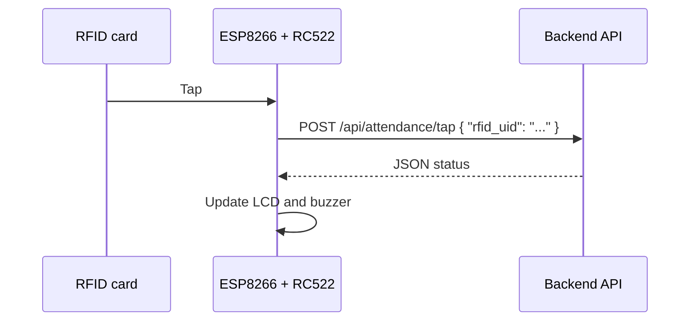
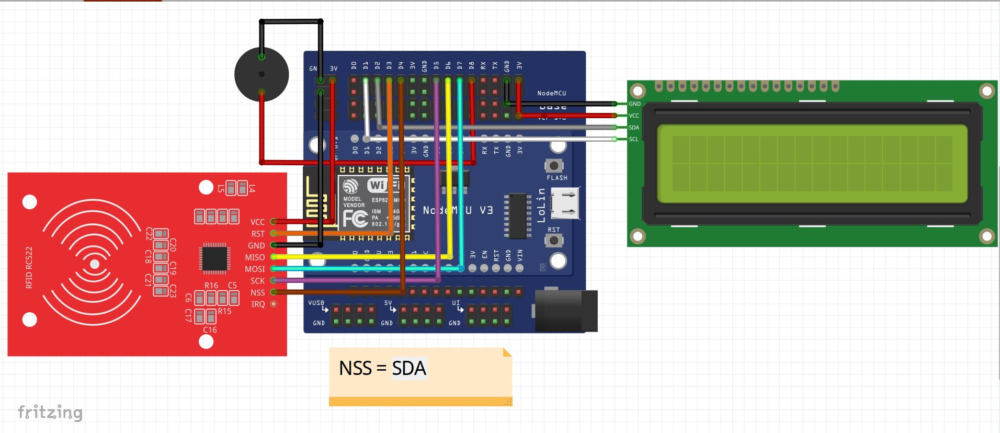

<div align="center">

# IoT RFID Attendance System

An RFID attendance terminal for **HMIF UNMA** (Himpunan Mahasiswa Informatika, Universitas Majalengka).<br>
The firmware runs on an ESP8266 (NodeMCU) with an RC522 reader. It reads a student ID card,<br>
posts the card UID to a backend REST API, and shows the result on a 16x2 LCD and a buzzer.


</div>

## Table of Contents

- [Features](#features)
- [How It Works](#how-it-works)
- [Hardware](#hardware)
- [Software Requirements](#software-requirements)
- [Getting Started](#getting-started)
- [Device Feedback](#device-feedback)
- [API Reference](#api-reference)
- [Project Structure](#project-structure)
- [Troubleshooting](#troubleshooting)
- [Security Notes](#security-notes)

## Features

- WiFi provisioning through a captive portal (WiFiManager), so no credentials are hardcoded.
- Card UIDs are sent to the backend over HTTPS as JSON.
- The LCD shows the member's first name and whether the check-in was on time or late, including the minutes late.
- The buzzer uses a distinct pattern for success, warning, connection error, and server error.
- Network failures, invalid JSON, rejected cards, and closed schedules each have their own on-screen message.
- Pressing the reset button twice during startup erases the saved WiFi credentials.

## How It Works



## Hardware

### Bill of Materials

| Component | Description | Qty |
| --- | --- | --- |
| NodeMCU V3 | ESP8266 WiFi microcontroller | 1 |
| RFID-RC522 | 13.56 MHz RFID reader | 1 |
| LCD 1602 | 16x2 character display | 1 |
| I2C backpack | PCF8574 I2C adapter for the LCD | 1 |
| Buzzer | Piezo buzzer. Use a passive buzzer if you want the different pitches, because the firmware varies the frequency with `tone()`. | 1 |
| Jumper wires | Female-to-female or male-to-female | 1 set |

### Wiring



| Component | Pin | NodeMCU pin | Notes |
| --- | --- | --- | --- |
| RC522 | SDA (SS) | D4 (GPIO2) | Chip select |
| RC522 | SCK | D5 (GPIO14) | SPI clock |
| RC522 | MISO | D6 (GPIO12) | SPI MISO |
| RC522 | MOSI | D7 (GPIO13) | SPI MOSI |
| RC522 | RST | D3 (GPIO0) | Reset |
| RC522 | 3.3V | 3V3 | Power the RC522 from 3.3 V only |
| RC522 | GND | GND | |
| LCD (I2C) | SDA | D2 (GPIO4) | |
| LCD (I2C) | SCL | D1 (GPIO5) | |
| LCD (I2C) | VCC | 5V / VIN | The pin label varies by board |
| LCD (I2C) | GND | GND | |
| Buzzer | (+) | D8 (GPIO15) | Signal |
| Buzzer | (-) | GND | |

The firmware expects the LCD at I2C address `0x27`. Some backpacks use `0x3F`; change `I2C_ADDR` in the sketch if yours does.

## Software Requirements

- [Arduino IDE](https://www.arduino.cc/en/software) 1.8.x or 2.x
- ESP8266 board package. Add `http://arduino.esp8266.com/stable/package_esp8266com_index.json` under **File > Preferences > Additional Boards Manager URLs**, then install **esp8266** from the Boards Manager.

Install these libraries from the Library Manager:

| Library | Author | Version |
| --- | --- | --- |
| MFRC522 | GithubCommunity | Latest |
| ArduinoJson | Benoit Blanchon | 6.x (the code uses `DynamicJsonDocument`, which v7 deprecates) |
| WiFiManager | tzapu | Latest |
| LiquidCrystal_I2C | Frank de Brabander | Latest |

## Getting Started

### 1. Clone the repository

```bash
git clone https://github.com/wildanzm/iot-hmif.git
cd iot-hmif
```

### 2. Open the sketch

Open `code_v1.ino` in the Arduino IDE. The IDE will offer to move it into a folder named `code_v1`; accept.

### 3. Select the board

Choose **Tools > Board > ESP8266 Boards > NodeMCU 1.0 (ESP-12E Module)** and select the correct port.

### 4. Set the API endpoint and token

Edit the two constants at the top of `code_v1.ino`. Replace both placeholders with the endpoint and token of your own backend:

```cpp
const char* attendanceUrl = "https://your-server.example.com/api/attendance/tap";
const char* apiToken      = "YOUR_API_TOKEN_HERE";
```

Do not commit a real token. See [Security Notes](#security-notes).

### 5. Upload

Connect the NodeMCU over USB and click **Upload**. Open the Serial Monitor at **115200 baud** to follow the device logs.

### 6. Connect the device to WiFi

1. Power on the device. The LCD shows "Menghubungkan ke Internet...".
2. With no saved network, the device starts an access point named **Core HMIF**.
3. Join that network from a phone or laptop. The captive portal should open on its own; otherwise browse to `192.168.4.1`.
4. Choose your WiFi network and enter the password.
5. The device saves the credentials and connects. The portal times out after 180 seconds, and the device restarts if nobody configures it in that time.

### Resetting saved WiFi credentials

1. Press **RST** to restart the device.
2. While the LCD still shows "Menghubungkan ke Internet...", press **RST** again.
3. A two-tone beep (high, then low) confirms the credentials were erased. The configuration portal then opens with a 300-second timeout.

The second press must land before the device finishes connecting to WiFi. A device with working saved credentials connects quickly, so press the second time right after the first.

## Device Feedback

### LCD messages

The display text is in Indonesian.

| Situation | Line 1 | Line 2 |
| --- | --- | --- |
| Booting | Menunggu | Instalasi |
| Connecting to WiFi | Menghubungkan | ke Internet... |
| WiFi connected | Berhasil | Terhubung! |
| Idle, ready for a card | Selamat Datang | Vistara Abhiyasa |
| Waiting for the server | Tunggu Sebentar | ........ |
| Checked in on time | Selamat Datang | First name |
| Checked in late | Terlambat! | `N` Menit |
| Already checked in today | Kamu Sudah | Absen Hari Ini |
| No schedule exists | Info | Tdk Ada Jadwal |
| Schedule is closed | Info | Absen Ditutup |
| Rejected by server | Sistem Error | Kartu Ditolak |
| Unrecognized response | Sistem Error | Tidak Terdaftar |
| Response is not valid JSON | Server Error | Tidak Valid |
| WiFi dropped | Koneksi Internet | Terputus! |
| HTTP request failed | Koneksi Gagal | |

To change the idle text, edit the two `lcdPrintCentered(...)` calls in `setup()` and `loop()`.

### Buzzer patterns

| Event | Pattern |
| --- | --- |
| Device ready | One beep, 2000 Hz |
| Success | One short beep, 3000 Hz |
| Late check-in, or already checked in | Three quick beeps, 1500 Hz |
| Connection error | Two low beeps, 300 Hz |
| Server or card error | One long low beep, 300 Hz |
| WiFi credentials erased | 1000 Hz, then 500 Hz |

## API Reference

The device sends one request per card tap.

```http
POST /api/attendance/tap
Content-Type: application/json
Accept: application/json
X-API-TOKEN: <your-token>
```

```json
{
  "rfid_uid": "A1B2C3D4"
}
```

The UID is the card's bytes in uppercase hex, with a leading zero on each byte below `0x10`.

### Responses the firmware handles

| Response | Device behavior |
| --- | --- |
| `{"status": "success", "data": {...}}` with `attendance_status` other than `"Terlambat"` | On-time check-in |
| `{"status": "success", "data": {...}}` with `attendance_status` of `"Terlambat"` | Late check-in, shows `lateness_minutes` |
| `{"status": "warning", ...}` | Already checked in today |
| Any other `status` | Card rejected |
| `{"message": "..."}` containing `No active schedule` | No schedule exists |
| `{"message": "..."}` containing `No schedule is active` | Schedule is closed |
| Any other `message` | Check-in failed |
| Neither `status` nor `message` | Unrecognized response |

A successful response looks like this:

```json
{
  "status": "success",
  "data": {
    "user_name": "Jane Doe",
    "attendance_status": "Terlambat",
    "lateness_minutes": 12
  }
}
```

The LCD shows only the first word of `user_name`. Use `"Hadir"` for `attendance_status` on an on-time check-in and set `lateness_minutes` to `0`.

## Project Structure

```text
iot-hmif/
├── code_v1.ino       # Firmware
├── schema/
│   └── schema.png    # Wiring diagram
└── README.md
```

## Troubleshooting

| Symptom | Likely cause and fix |
| --- | --- |
| LCD is blank | Wrong I2C address. Try `0x3F`. Also adjust the contrast potentiometer on the backpack. |
| Card is never detected | Check the RC522 wiring and confirm it is powered from 3.3 V. |
| Configuration portal does not open | Join the **Core HMIF** network manually and browse to `192.168.4.1`. |
| "Koneksi Gagal" | The HTTP request failed. Check the Serial Monitor for the error code, the URL, and the network. |
| "Server Error / Tidak Valid" | The server returned a response that is not JSON. Check the endpoint and the token. |
| WiFi reset does not trigger | Press **RST** the second time sooner, while the LCD still says "Menghubungkan ke Internet...". |

## Security Notes

- The firmware calls `client.setInsecure()`, which skips TLS certificate validation. Traffic is encrypted, but the device cannot verify the server's identity. Pin the server certificate or its fingerprint before using this on an untrusted network.
- The API token lives in the source file. Keep the real value out of version control and rotate it if it leaks.
